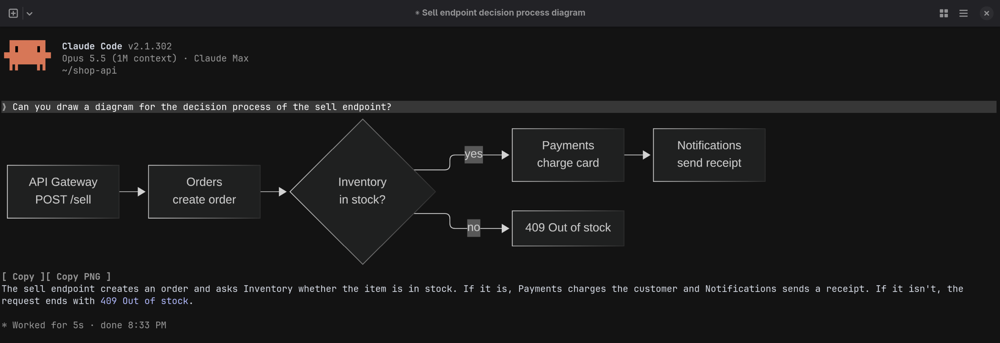
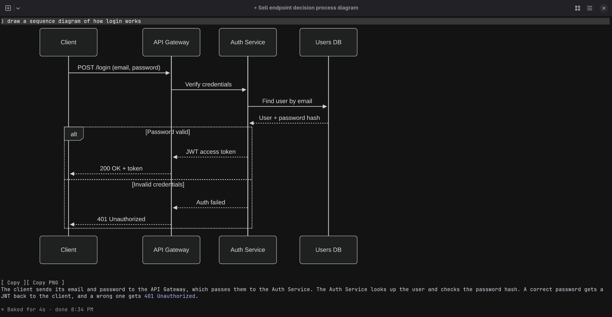

# cc-diagrams

A Claude Code plugin that draws mermaid blocks in Claude code CLI.






Press **Copy** under a diagram to put its Mermaid code on the clipboard, or **Copy PNG**
for the image (needs `wl-copy`, `xclip` or macOS)

## Requirements

[mermaid-cli](https://github.com/mermaid-js/mermaid-cli) on your `PATH`:

```sh
npm i -g @mermaid-js/mermaid-cli
```
Works it terminal emualator has kitty graphics protocol

## Install

At the prompt of a Claude Code terminal session:

```
/plugin install cc-diagrams --marketplace pablofrr/cc-diagrams
```

Answer `y` to add the marketplace, then pick a scope.

## Develop

```sh
claude plugin validate .
claude plugin test .
claude --plugin-dir .
```

Rendered diagrams are cached in `~/.cache/cc-diagrams`.
